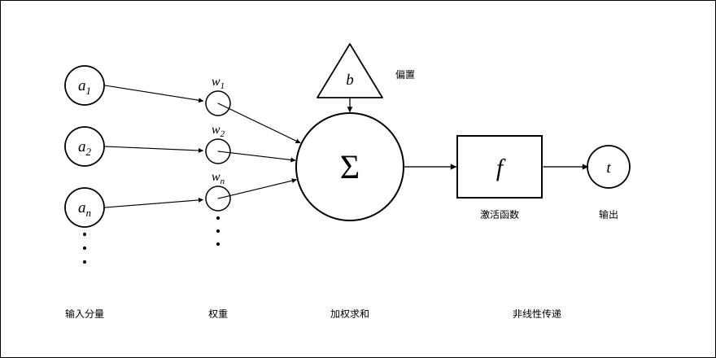
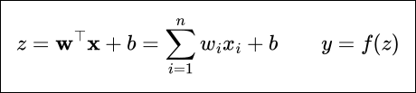
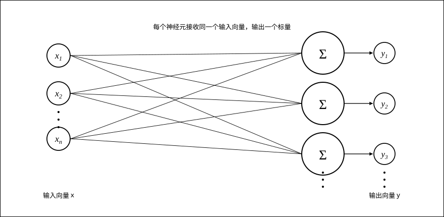
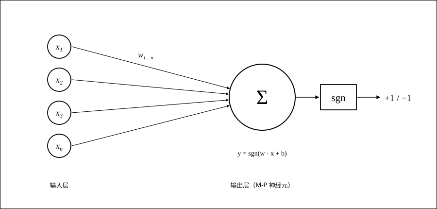
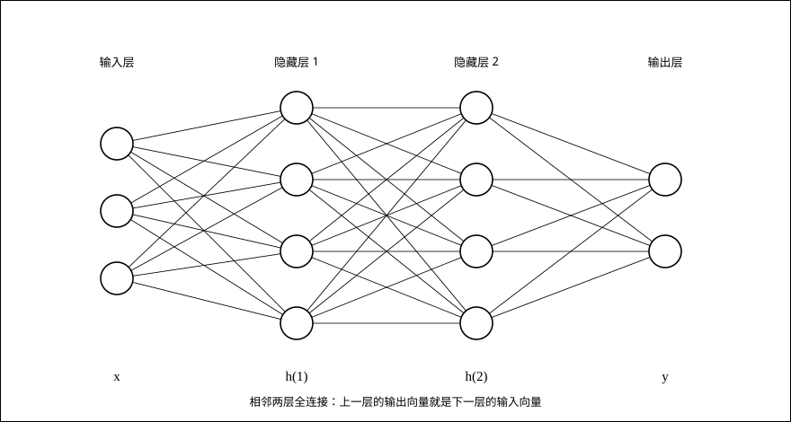
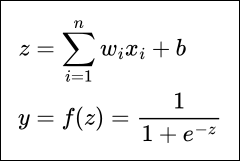
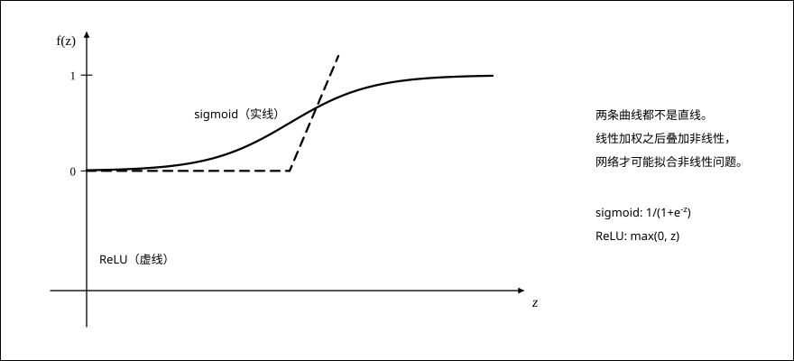
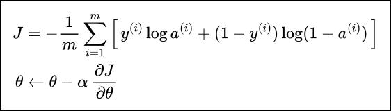
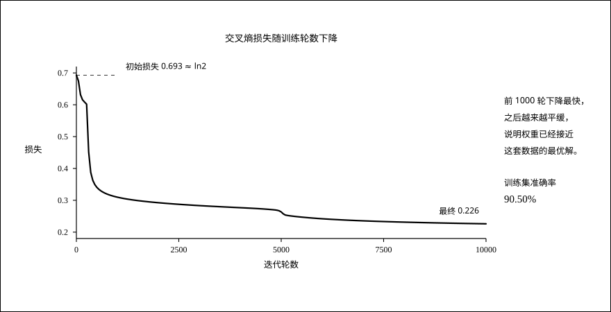

神经网络由大量神经元按一定的层次结构连接而成。每个神经元接收多个输入，每个输入都带着一个对应的权重，另外还有一个偏置；训练的过程，就是拿已有的输入与输出数据，通过数学方法不断调整这些权重和偏置，让网络对给定的输入逐步给出正确的输出。训练完成之后，网络就可以对没见过的数据做预测，得到一个很接近真实值的预测值。

## 一、单个神经元

单一神经元的结构如图 1 所示。



*图 1　左侧的小圆是输入分量，中间的小圆是各个输入分量对应的权重，大圆旁边的三角形是偏置，大圆把输入与权重的乘积加总起来，矩形是激活函数，最右边引出的小圆是这个神经元的输出。*

图中 a₁、a₂⋯aₙ 表示各个输入的分量，w₁、w₂⋯wₙ 表示每个输入分量对应的权重，大圆旁边的三角形 b 表示偏置，大圆后跟随的矩形 f 表示激活函数，矩形后引出的小圆 t 表示神经元的输出。

| 符号 | 含义 |
| --- | --- |
| a₁…aₙ | 输入分量，合起来就是输入向量 x |
| w₁…wₙ | 每个输入分量对应的权重，合起来就是权重向量 w |
| b | 偏置，相当于把加权和整体平移一个量 |
| z | 加权求和（内积）的结果 |
| f | 激活函数，负责引入非线性 |
| t | 神经元输出的标量 |

使用数学公式表示：



左边先把输入向量与权重向量做内积（也就是把每个 aᵢ 与对应的 wᵢ 相乘后求和），再加上偏置 b，得到加权和 z；右边把 z 送进激活函数 f，得到神经元的输出 y。一句话概括单个神经元：**求得输入向量与权向量的内积之后，再经过一个非线性传递函数，得到一个标量结果**。把许多这样的神经元按照一定的层次结构连接起来，就得到了神经网络。

## 二、按层次分类

依据层次结构，常见的神经网络有下面几种。

### 单层神经网络



*图 2　有限个神经元并排，所有神经元的输入都是同一个输入向量，每个神经元输出一个标量，合起来是一个向量。*

单层神经网络由有限个神经元构成，所有神经元的输入向量都是同一个向量。由于每一个神经元都会产生一个标量结果，所以单层神经网络的输出是一个向量，向量的维数等于神经元的数目。写成矩阵形式就是 `y = f(Wx + b)`：权重矩阵 W 的每一行，正好对应一个神经元的权重。

### 感知机



*图 3　感知机由输入层和输出层组成，输出层是一个 M-P 神经元，用符号函数把加权和压成 +1 或 −1。*

感知机由两层神经网络组成：输入层接收外界输入信号后传递给输出层，输出层是 M-P 神经元，输出 +1 表示正例、−1 表示反例。因为符号函数只做“过线还是没过线”的判断，感知机能够表达的分界只有一条超平面，所以它只能处理线性可分的问题；像异或（XOR）这样线性不可分的问题，单层感知机是无解的。这正是后面要引入隐藏层的原因。

### 多层神经网络



*图 4　把若干单层神经网络首尾相接，就形成了“层”的概念，相邻两层之间全连接。*

多层神经网络由单层神经网络叠加得到，于是就形成了“层”的概念。常见的多层神经网络包含三类层：

- **输入层（Input layer）**：众多神经元接受大量输入消息，输入的消息称为输入向量。
- **输出层（Output layer）**：消息在神经元的连接中传输、分析、权衡，形成输出结果，输出的消息称为输出向量。
- **隐藏层（Hidden layer）**：简称“隐层”，是输入层和输出层之间由众多神经元和连接组成的各个层面。隐层可以有一层，也可以有多层；隐层中神经元的数目不定，但数目越多，神经网络的非线性越显著，从而神经网络的强健性（robustness）越显著。

## 三、激活函数与加权求和

人工神经元接收到一个或多个输入，对它们进行加权并相加，总和再通过一个激活函数产生输出。激活函数总是非线性的，这是因为现实生活中的问题大多是非线性的，于是需要在本来看起来是线性的神经网络中加入这种非线性因素。



也就是：所有的输入 xᵢ 与相应的权重 wᵢ 相乘并求和，把求和结果送入激活函数，得到最终的输出结果。

为什么一定要非线性？如果 f 是线性函数，那么两层线性变换叠在一起仍然是线性变换，多层网络就退化成了一个单层网络，加多少层都没有意义。正因为每一层后面都夹着一个非线性函数，网络才有能力去拟合弯曲的、甚至非常复杂的分界。



*图 5　sigmoid 把任意实数压到 (0, 1) 之间，ReLU 在 0 以下截断、0 以上保持线性。两条曲线都不是直线。*

- **sigmoid**：`1 / (1 + e^(-z))`，输出落在 (0, 1)，常用来表示概率；
- **tanh**：输出落在 (−1, 1)，是零中心的，常作隐藏层的激活函数；
- **ReLU**：`max(0, z)`，计算简单，正区间不会饱和。

## 四、用 numpy 手写一遍

下面这段代码只依赖 numpy，把前三节讲的东西完整走一遍：造一个线性不可分的平面数据集 → 前向传播算输出 → 交叉熵算损失 → 反向传播求梯度 → 梯度下降更新权重 → 用训练好的权重做预测。代码与讲解思路参考仓库中的 `docs/ai/神经网络实战`。

```python
# -*- coding: utf-8 -*-
"""用 numpy 手写一个两层的神经网络，并在“平面”数据集上训练。
思路参考仓库 docs/ai/神经网络实战/work1.py，去掉了 matplotlib / sklearn 依赖。"""

import numpy as np

# ---------- 1. 造数据：交叉的花瓣形状，两类样本混在一起，线性不可分 ----------
np.random.seed(1)                       # 固定随机种子，保证每次运行结果可复现


def load_planar_dataset(n=200, noise=0.2):
    m = 2 * n                           # 每类 n 个样本，共 2n 个
    X = np.zeros((2, m))                # X 形状 (2, m)：第 0 行 x1，第 1 行 x2
    Y = np.zeros((1, m))                # Y 形状 (1, m)：标签 0（内圈）或 1（外圈）
    for j in range(2):                  # j = 0 内圈，j = 1 外圈
        t = np.linspace(j * 3.12, (j + 1) * 3.12, n) + np.random.randn(n) * noise
        r = 4 * np.sin(4 * t) + np.random.randn(n) * noise   # 花瓣形状的半径
        X[0, j * n:(j + 1) * n] = r * np.sin(t)              # 极坐标转直角坐标
        X[1, j * n:(j + 1) * n] = r * np.cos(t)
        Y[0, j * n:(j + 1) * n] = j                          # 打上类别标签
    return X, Y


# ---------- 2. 激活函数：隐藏层用 tanh，输出层用 sigmoid ----------
def sigmoid(z):
    return 1 / (1 + np.exp(-z))         # 把任意实数压到 (0, 1)，可解释成概率


def layer_sizes(X, Y):
    n_x = X.shape[0]                    # 输入维度：这里是 2
    n_h = 4                             # 隐藏层神经元个数：自己定，越多越“能拟合”
    n_y = Y.shape[0]                    # 输出维度：这里是 1（二分类）
    return n_x, n_h, n_y


def initialize_parameters(n_x, n_h, n_y):
    np.random.seed(2)                                   # 让初始化也可复现
    W1 = np.random.randn(n_h, n_x) * 0.01               # 小随机数，打破对称
    b1 = np.zeros((n_h, 1))                             # 偏置初始化为 0
    W2 = np.random.randn(n_y, n_h) * 0.01
    b2 = np.zeros((n_y, 1))
    return {"W1": W1, "b1": b1, "W2": W2, "b2": b2}


# ---------- 3. 前向传播：一层一层把输入算成输出 ----------
def forward_propagation(X, parameters):
    W1, b1 = parameters["W1"], parameters["b1"]
    W2, b2 = parameters["W2"], parameters["b2"]

    Z1 = np.dot(W1, X) + b1             # 隐藏层的加权和，形状 (4, m)
    A1 = np.tanh(Z1)                    # 隐藏层的激活值，非线性就发生在这里
    Z2 = np.dot(W2, A1) + b2            # 输出层的加权和，形状 (1, m)
    A2 = sigmoid(Z2)                    # 输出层的激活值，可看作“属于类别 1 的概率”

    cache = {"Z1": Z1, "A1": A1, "Z2": Z2, "A2": A2}
    return A2, cache


# ---------- 4. 损失函数：交叉熵，衡量预测概率与真实标签的差距 ----------
def compute_cost(A2, Y):
    m = Y.shape[1]
    cost = -np.sum(Y * np.log(A2) + (1 - Y) * np.log(1 - A2)) / m
    return float(np.squeeze(cost))


# ---------- 5. 反向传播：算出每个参数该往哪个方向调 ----------
def backward_propagation(parameters, cache, X, Y):
    m = X.shape[1]
    W2 = parameters["W2"]
    A1, A2 = cache["A1"], cache["A2"]

    dZ2 = A2 - Y                                            # 输出层误差
    dW2 = np.dot(dZ2, A1.T) / m
    db2 = np.sum(dZ2, axis=1, keepdims=True) / m
    dZ1 = np.dot(W2.T, dZ2) * (1 - np.power(A1, 2))          # tanh 的导数：1 - tanh^2
    dW1 = np.dot(dZ1, X.T) / m
    db1 = np.sum(dZ1, axis=1, keepdims=True) / m
    return {"dW1": dW1, "db1": db1, "dW2": dW2, "db2": db2}


# ---------- 6. 梯度下降：把参数往梯度的反方向挪一小步 ----------
def update_parameters(parameters, grads, learning_rate=0.5):
    for key in parameters:
        parameters[key] = parameters[key] - learning_rate * grads["d" + key]
    return parameters


# ---------- 7. 组装成模型：前向 → 算损失 → 反向 → 更新，循环若干轮 ----------
def nn_model(X, Y, num_iterations=10000, print_cost=True):
    n_x, n_h, n_y = layer_sizes(X, Y)
    parameters = initialize_parameters(n_x, n_h, n_y)
    for i in range(num_iterations):
        A2, cache = forward_propagation(X, parameters)          # 前向
        grads = backward_propagation(parameters, cache, X, Y)   # 反向
        parameters = update_parameters(parameters, grads)       # 更新
        if print_cost and i % 1000 == 0:
            print(f"第 {i:>5d} 轮迭代，损失 {compute_cost(A2, Y):.6f}")
    return parameters


def predict(parameters, X):
    A2, _ = forward_propagation(X, parameters)
    return np.round(A2)                 # 概率 > 0.5 判为 1，否则判为 0


if __name__ == "__main__":
    X, Y = load_planar_dataset()
    print("X 形状:", X.shape, " Y 形状:", Y.shape)
    params = nn_model(X, Y)
    pred = predict(params, X)
    print("训练集准确率: {:.2f}%".format(100 * np.mean(pred == Y)))
```

运行结果：

```text
X 形状: (2, 400)  Y 形状: (1, 400)
第     0 轮迭代，损失 0.693048
第  1000 轮迭代，损失 0.309802
第  2000 轮迭代，损失 0.292433
第  3000 轮迭代，损失 0.283349
第  4000 轮迭代，损失 0.276781
第  5000 轮迭代，损失 0.263472
第  6000 轮迭代，损失 0.242044
第  7000 轮迭代，损失 0.235525
第  8000 轮迭代，损失 0.231410
第  9000 轮迭代，损失 0.228464
训练集准确率: 90.50%
```

这段代码做的事情，正好对应下面这组公式：



- 第一行是**交叉熵损失** J：m 是样本数，a⁽ⁱ⁾ 是网络对第 i 个样本给出的概率，y⁽ⁱ⁾ 是它的真实标签。预测越接近真实标签，J 就越小，训练的目标就是把它压下去。
- 第二行是**梯度下降**：θ 代表任意一个参数（W1、b1、W2、b2 都按这个式子更新），α 是学习率，∂J/∂θ 是损失对这个参数的偏导数。沿着梯度的反方向挪一小步，损失就会变小一点；重复足够多轮，参数就收敛了。
- 代码里的反向传播，意义就是从输出层的误差 `dZ2 = A2 - Y` 开始，把误差一层一层往回传，逐层算出每个参数的梯度，供第二行使用。`dZ1 = dot(W2.T, dZ2) * (1 - A1**2)` 里的 `1 - tanh²` 就是 tanh 的导数。



*图 6　损失在前 1000 轮下降最快，之后越来越平缓，说明权重已经接近这套数据的最优解。*

训练结束后，400 个训练样本上的准确率是 90.50%。剩下那约 10% 的样本基本落在两类交叠的区域，这已经接近这个“4 个隐藏神经元 + tanh + sigmoid”的网络在这份数据上的拟合上限；把隐藏层加宽、换用更合适的激活函数或者更好的优化方法，都可以把这个数字再往上推一点。

一句话把整篇串起来：神经网络就是一堆“加权求和 + 非线性激活”的单元按层次连接起来的网络；训练是用梯度下降根据损失反复调整权重；预测则是把新输入送进这张已经调好的网络，一层一层算过去。
